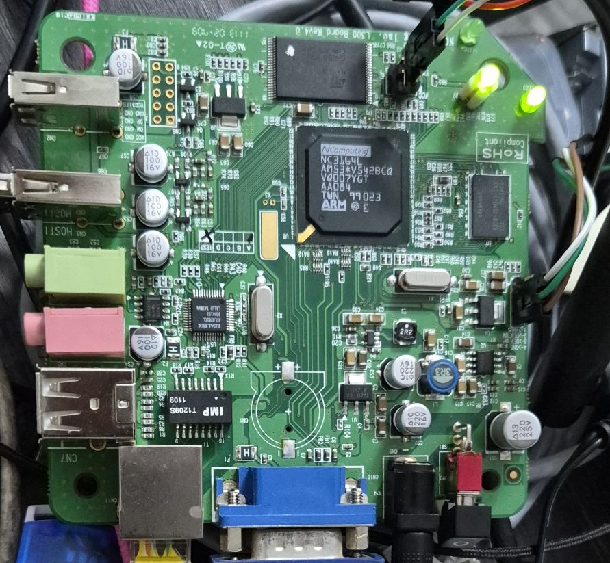

# nComputing L300 - SPEAr600 Embedded Linux

Embedded Linux workspace for the **nComputing L300** thin client, repurposed as a general-purpose ARM Linux board.




## Hardware

| Component | Details |
|-----------|---------|
| SoC | STMicroelectronics SPEAr600 (ARM926EJ-S, ARMv5TEJ) |
| RAM | 128MB DDR2 |
| Storage | 128MB NAND Flash |
| Display | VGA output (1024x768x24) |
| Network | 10/100 Ethernet (RTL8201CL PHY) |
| USB | 4x USB 2.0 host ports |
| Serial | UART console (ttyS0, 115200 baud) |

## Software

- **Kernel:** Linux 2.6.19.2 (original nComputing BSP)
- **Rootfs:** Minimal 3.2MB initramfs (BusyBox 1.14.2, uClibc 0.9.27)
- **fbterm:** Framebuffer terminal with USB keyboard support — 8x16 bitmap font, 128x48 chars, green-on-black
- **fbvnc_server:** VNC server on port 5900 with keyboard input
- **Network:** Dropbear SSH, telnetd, DHCP; eth0 MAC read per unit from `/sbin/getdevprop mac` (fallback `00:1A:2B:3C:4D:5E`)

## NAND Flash Layout

| Offset | Size | Description |
|--------|------|-------------|
| 0x000000 | 5.4KB | X-Loader (BootROM -> DDR init) |
| 0x080000 | 180B | FWD boot config |
| 0x0E0000 | 208KB | U-Boot 1.2.2 |
| 0x1A0000 | 1.6MB | Linux kernel (uImage) |
| 0x600000 | ~3.2MB | Minimal initramfs (cpio+gzip) |

## Quick Start

Pre-built system images are in `system_images/`. See [FLASH_GUIDE.md](system_images/FLASH_GUIDE.md) for step-by-step flashing instructions.

After flashing, the board auto-boots on power-up. Access via:
- **VGA + USB keyboard** (direct framebuffer terminal)
- **VNC** on port 5900
- **SSH/telnet** (root, no password)

## Building

### Cross-compilation (ELDK 4.1)

The board requires OABI binaries (ELF flags `0x602`). Use the ELDK 4.1 toolchain:

```bash
export PATH=/path/to/eldk41/usr/bin:/path/to/eldk41/bin:$PATH
export ELDKARM=/path/to/eldk41/arm
arm-linux-gcc -static -O2 \
    -I${ELDKARM}/usr/include \
    -L${ELDKARM}/lib -L${ELDKARM}/usr/lib \
    -o output source.c
```

### Building initramfs

Extract the original nComputing initramfs, modify, and repack. Do NOT change file ownership.

```bash
mkdir /tmp/rootfs && cd /tmp/rootfs
gunzip -c original_initramfs.gz | sudo cpio -idm
# Make changes...
sudo find . | sudo cpio -o -H newc 2>/dev/null | gzip > new_initramfs.gz
```

## Key Findings

- **jffs2 mounts must be disabled** — the kernel's built-in MTD partition table maps mtdblock2/3 over the initramfs NAND area (0x600000), erasing it on boot. `CONFIG_MTD_CMDLINE_PARTS` is not enabled, so the `mtdparts` boot parameter is ignored.
- **saveenv corrupts NAND** — do not use it; the environment storage overlaps with other NAND partitions
- **`boot` command is broken at U-Boot prompt** — autoboot timer works, but typing `boot` manually does not. Use autoboot or run steps individually.
- **Console is `ttyS0`**, not `ttyAMA0`
- **Per-unit MAC is in firmware data, not in an I2C EEPROM** — the EEPROM is absent, but `/sbin/getdevprop mac` returns the real MAC (NComputing OUI) and `getdevprop sn` the serial; `rc.sh` sets eth0 from it (fallback `00:1A:2B:3C:4D:5E` if the read fails)
- **OABI only** — kernel 2.6.19 does not support EABI5 binaries
- **Do not chown initramfs** — `sudo chown -R root:root` on the extracted initramfs breaks boot; preserve original uid 1002

## Project Structure

```
system_images/      # Pre-built images for flashing from scratch
fbvnc/              # Framebuffer terminal + VNC server source
firmware/           # Boot images and initramfs config
  initramfs_orig/   # Modified rootfs (etc/rc.sh, inittab, etc.)
tools/              # Deploy scripts and utilities
packages/           # opkg package builder
```

## License

MIT License -- see [LICENSE](LICENSE)
