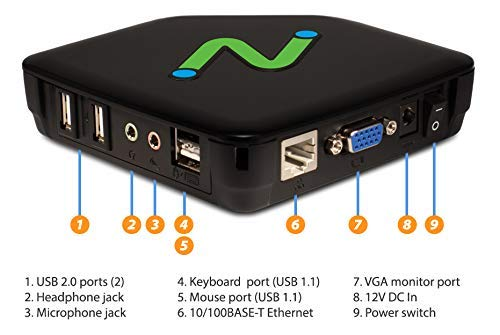

# nComputing L300 - SPEAr600 Embedded Linux

Embedded Linux workspace for the **nComputing L300** thin client, repurposed as a general-purpose ARM Linux board.




## Hardware

| Component | Details |
|-----------|---------|
| SoC | STMicroelectronics SPEAr600 (ARM926EJ-S, ARMv5TEJ) |
| RAM | 128MB DDR2 |
| Storage | 128MB NAND Flash |
| Display | VGA output (1024x768x24) |
| Network | 10/100 Ethernet (RTL8201CL PHY) |
| USB | 4x USB 2.0 host ports |
| Serial | UART console (ttyS0, 115200 baud) |

## Software

- **Kernel:** Linux 2.6.19.2 (original nComputing BSP)
- **Rootfs:** Custom initramfs (BusyBox 1.14.2, uClibc 0.9.27)
- **fbterm:** Framebuffer terminal — 8x16 bitmap font, 128x48 chars, green-on-black
- **fbvnc_server:** VNC server on port 5900 with keyboard input
- **Network:** Dropbear SSH, telnetd, DHCP

## NAND Flash Layout

| Offset | Size | Description |
|--------|------|-------------|
| 0x000000 | 5.4KB | X-Loader (BootROM → DDR init) |
| 0x080000 | 180B | FWD boot config |
| 0x0E0000 | 208KB | U-Boot 1.2.2 |
| 0x1A0000 | 1.6MB | Linux kernel (uImage) |
| 0x600000 | ~11.6MB | Initramfs (cpio+gzip) |

## Building

### Cross-compilation (ELDK 4.1)

The board requires OABI binaries (ELF flags `0x602`). Use the ELDK 4.1 toolchain:

```bash
export PATH=/path/to/eldk41/usr/bin:/path/to/eldk41/bin:$PATH
export ELDKARM=/path/to/eldk41/arm
arm-linux-gcc -static -O2 \
    -I${ELDKARM}/usr/include \
    -L${ELDKARM}/lib -L${ELDKARM}/usr/lib \
    -o output source.c
```

### Building initramfs

```bash
cd firmware/initramfs_orig/
sudo chown -R root:root .
find . | sudo cpio -o -H newc 2>/dev/null | gzip > ../l300_initramfs_mod.gz
```

## Flashing

### Via U-Boot TFTP

```
setenv serverip 192.168.11.121
setenv ipaddr 192.168.11.200
setenv ethaddr 00:1A:2B:3C:4D:5E
tftpboot 0x800000 <file>
nand erase <offset> <size>
nand write.jffs2 0x800000 <offset> <size>
```

## Key Findings

- **mtdparts is required** in bootargs — without it, the kernel's built-in partition table maps jffs2 over the initramfs NAND area, erasing it on boot
- **Console is `ttyS0`**, not `ttyAMA0`
- **I2C EEPROM is missing** — MAC address must be set manually at boot
- **OABI only** — kernel 2.6.19 does not support EABI5 binaries

## Project Structure

```
fbvnc/              # Framebuffer terminal + VNC server source
firmware/           # Boot images and initramfs config
  initramfs_orig/   # Modified rootfs (etc/rc.sh, inittab, etc.)
tools/              # Deploy scripts and utilities
packages/           # opkg package builder
```

## License

MIT License — see [LICENSE](LICENSE)
